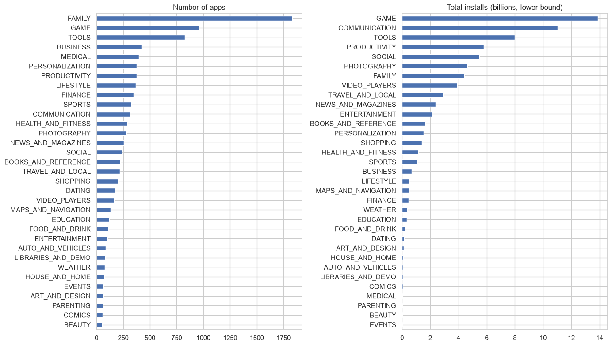

# The Android app market on Google Play

Exploratory analysis of about 9,700 Google Play apps and a sample of user reviews: categories, ratings, pricing, and paid versus free apps.



## Data

`datasets/apps.csv` and `datasets/user_reviews.csv` (scraped from Google Play). The data comes from the DataCamp project of the same name.

## Key results

- Games are 10% of apps but about 18% of installs; Family is 19% of apps and 6% of installs.
- 77% of rated apps score 4.0 or higher, so a rating in the low 4s is merely average.
- About 90% of paid apps cost under $10; Medical and Business apps are the most expensive.

## Running the notebook

```bash
pip install -r requirements.txt
jupyter notebook notebook.ipynb
```
